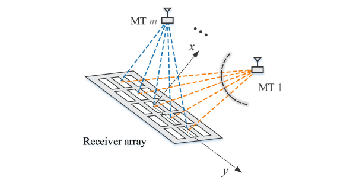
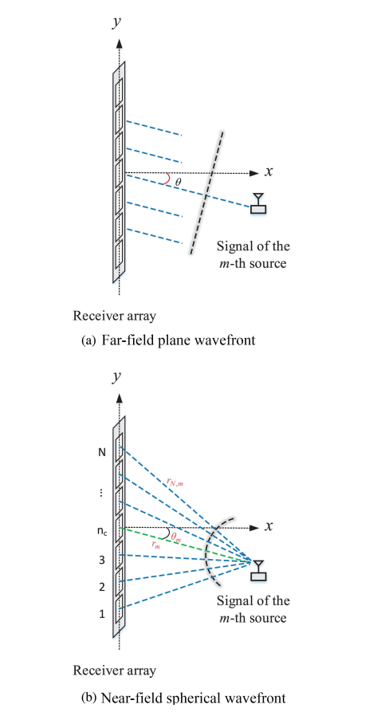
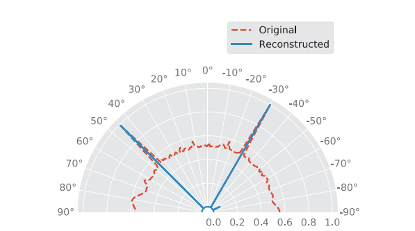
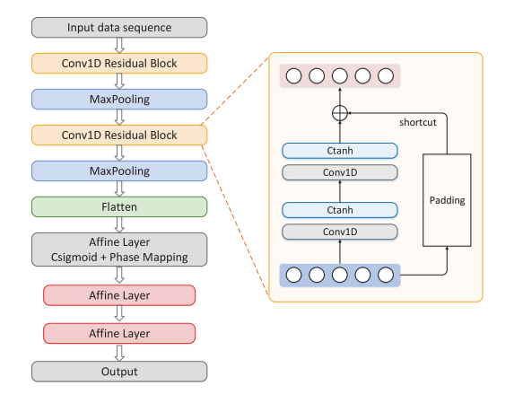
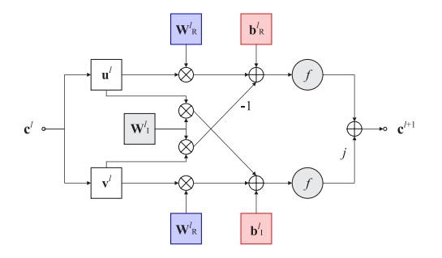
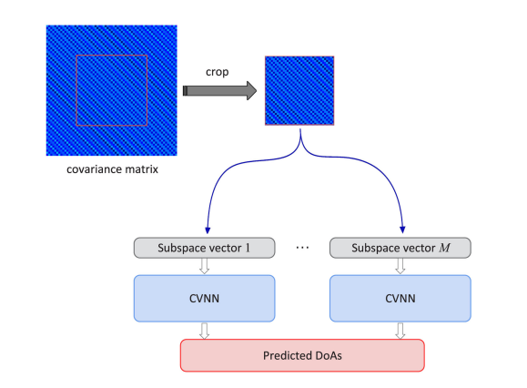
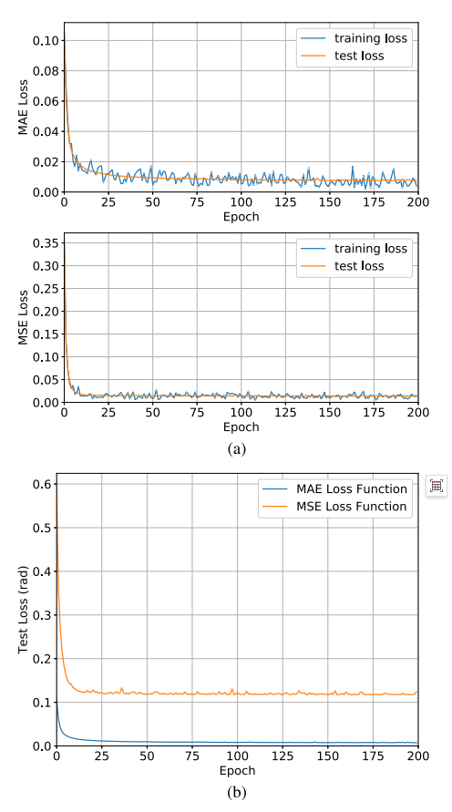
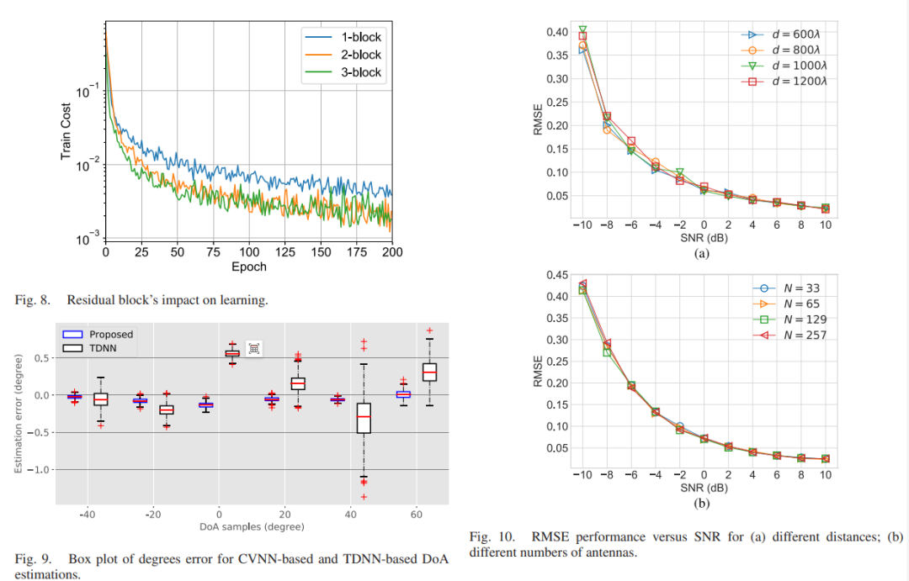
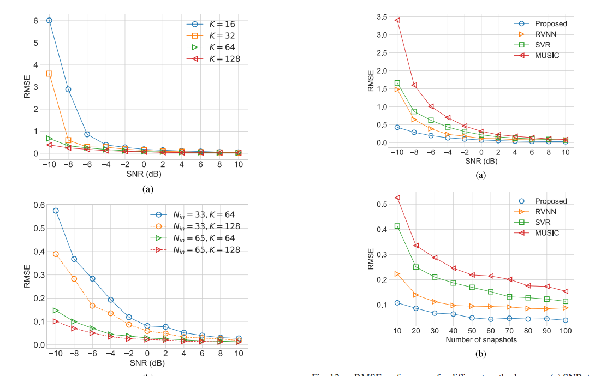

# DOA Estimation Based on Complex Residual Networks for Near-Field MIMO Systems with Received Signal Strength Indicator [with Python Code]

Abstract: The near-field effects of short-range multi-input multi-output (MIMO) systems pose numerous challenges to direction of arrival (DoA) estimation. Most traditional scenarios assume the existence of far-field plane wavefronts, whereas this paper investigates DoA estimation in short-range MIMO communication, where the influence of near-field spherical waves cannot be ignored. By transforming this problem into a regression task, this paper proposes a novel DoA estimation framework based on Complex Numerical Deep Learning (CVDL), suitable for the near-field region of short-range MIMO communication systems. Under the assumption of spherical wave model, the array steering vector is determined by both distance and direction, but solving this complex regression task with many variables is extremely challenging due to the need to capture numerous complex feature representations in the dataset. To address this issue, this paper constructs a virtual covariance matrix (VCM) based on received signals, and features extracted from VCM can handle the complex coupling relationship between direction and distance. Despite the advancement of wireless signal processing technology based on deep learning driven by future communication networks, learning algorithms for complex numerical signals are still in an exploratory stage. This paper introduces a one-dimensional (1-D) residual network, benefiting from the inherent one-dimensional structure of the signal subspace vectors, which can directly process complex numerical features. Additionally, this paper proposes a strategy based on cropped VCM, applicable to different antenna sizes. The proposed method fully utilizes the information of complex numbers, and simulation results show that the CVDL method proposed in this paper outperforms baseline schemes in terms of DoA estimation accuracy.
Keywords: Complex Numerical Deep Learning; DoA Estimation; MIMO; Near-field; Regression Task
Introduction: With the development of key enabling technologies such as millimeter-wave, small cell, and massive MIMO in the fifth-generation (5G) mobile communication, the problem of direction of arrival (DoA) estimation in large-scale MIMO systems has attracted widespread attention in recent years. Over the past decades, researchers have proposed various DoA estimation methods, including subspace techniques, maximum likelihood estimators, compression-sensing approaches, and hybrid methods. Efficient and accurate DoA estimation algorithms are crucial for large-scale MIMO systems, especially since precise DoA information is vital for beamforming design in large-scale MIMO systems.
Most of the above DoA estimation methods assume far-field plane wavefronts, but this assumption may no longer hold in future mobile systems. As a core enabling technology for 5G and subsequent mobile networks, millimeter-wave large-scale MIMO is expected to support high-rate communication, but short wavelengths and large antenna apertures pose challenges to propagation modeling. Considering Rayleigh distance, the last order scatterer may be in the near field of the receiving antenna, necessitating a spherical wave propagation model. On the other hand, near-field DoA estimation is also significant in applications such as vehicle-to-everything (V2X) communication, virtual reality, smart homes, and autonomous driving. Especially, landmark signal DoA estimation is a core technology for vehicle positioning, which is an important branch of Internet of Things (IoV).
Related Work and Research Motivation: In near-field DoA estimation, it is necessary to jointly estimate distance and angle, which expands the search space and increases the search overhead. To address this issue, some studies have proposed subspace methods that do not require multidimensional search, but these methods require a large number of snapshots and high signal-to-noise ratio (SNR) to improve spatial resolution; on the other hand, there are studies proposing maximum likelihood methods based on iterative estimation for scenarios with few snapshots and low SNR, but as the dimensionality of parameters increases, it inevitably leads to slow processing speeds with iteration methods.
At the same time, wireless networks generate massive amounts of data, which can be leveraged through state-of-the-art machine learning (ML) techniques to extract useful information. Some research has explored the application of ML in DoA estimation: one study models near-field DoA estimation as a classification problem based on Support Vector Machines (SVM); another study applies deep neural networks (DNNs) to far-field acoustic DoA estimation but this classification model is not suitable for near-field estimation; Support Vector Regression (SVR) method has also been used for near-field source DoA estimation; Real-valued DNN (RVNN) is designed for DoA estimation in mixed large-scale MIMO channels. Traditionally, complex numbers are split into real and imaginary parts before being input into the network, but this processing may lose the correlation between the real and imaginary parts, leading to phase information loss.
Existing deep learning methods predominantly focus on the real domain, yet many wireless communication issues necessitate resolution within the complex domain. Integrating complex value neural networks (CVNN) with wireless signal processing holds promise for advancing intelligent radio technology. CVDL, which refers to deep neural networks capable of performing complex arithmetic operations and utilizing complex-valued weights, has been applied in image and speech processing. However, there are still numerous challenges in its application for near-field DoA estimation:
1  
Traditional near-field methods require high SNR, multiple snapshots or online iterative estimation, which are difficult to achieve real-time DoA estimation. Moreover, there is limited research on deep learning methods for near-field DoA estimation.
2  
Machine learning methods based on spatial spectrum search and classification cannot meet the precision requirements under coarse grids, and splitting real-valued networks will destroy their structure.
3  
The DoA of near-field signals is coupled with the distance parameter, making it not directly feasible to estimate DoA based on CVDL. The design of input features, activation functions, and loss functions urgently needs exploration.
This paper proposes a novel DoA estimation method for near-field MIMO systems assisted by CVDL, treating DoA estimation as an end-to-end regression task rather than a classification problem. The main contributions are as follows:
1  
From the perspective of machine learning, near-field DoA estimation is treated as a process of extracting phase features from input data. There is no need for complex grid-based classification; instead, training an end-to-end deep network to directly handle complex numerical tasks for angle estimation.
2  
Design a new feature based on reconstructed VCM instead of full or semi-covariance matrix as input to CVNN, greatly reduce the network computational complexity, transform near-field two-dimensional parameter estimation problem into one-dimensional DoA estimation problem, eliminate the complex coupling between distance and direction.
3  
Propose a one-dimensional convolutional complex residual network to process one-dimensional complex features, design the residual block architecture with shortcut connections to ensure training stability, design phase mapping activation functions for DoA estimation tasks, and select different complex value activation functions based on the distribution of the dataset in corresponding neuron layers.
4  
Compare the training results of different loss functions to determine the loss function that is suitable for this regression task, and improve prediction accuracy.
5  
Propose a scheme based on cropping VCM, realize the general CVNN model that can be used for different antenna sizes without redesigning network and reduce computation cost by fixing input shape.
Method Introduction: This paper considers a short-range communication system composed of multiple mobile terminals (MTs) and access points (APs) equipped with multi-antennas. The distance between the AP and terminal devices is typically no more than 10 meters, featuring line-of-sight (LoS) propagation characteristics. In large-scale MIMO scenarios, the large array size leads to increased Rayleigh distances, rendering the far-field assumption invalid, necessitating the adoption of an near-field spherical wavefront model. For uniform linear arrays (ULAs), we derive the near-field signal model for receiving signals, where the array steering vector is influenced by both distance and direction, exhibiting nonlinear coupling characteristics. In contrast, in the far-field model, the phase difference of the array steering vector is only linearly related to the DoA.
1. Preprocessing and feature extraction
To address the learning barriers caused by near-field parameter coupling, this paper proposes a signal preprocessing scheme: utilizing the Hermitian and Toeplitz properties of the far-field covariance matrix to construct a virtual covariance matrix (VCM) that approximates the far-field covariance matrix, eliminating the interference of distance parameters on the signal subspace. By performing singular value decomposition (SVD) on the VCM, we obtain a feature vector matrix equivalent to the far-field signal subspace, extracting only DoA information, achieving decoupling of distance and direction.
The design of the complex number deep neural network architecture consists of alternating modules of convolutional layers and pooling layers, a flatten layer, and fully connected layers:
1  
The residual block includes two one-dimensional convolutional layers, realized through shortcut connections to linearly superpose input with the nonlinear transformation result, ensuring training stability;
2  
Using max pooling layers to process the real and imaginary parts of the complex numbers separately, retaining key features;
3  
In terms of activation functions, the convolutional layers use bounded Ctanh functions to avoid singular points, and the fully connected layers employ tanh functions to enhance gradient boosting for small prediction differences, designing phase mapping activation functions to facilitate error calculation from the complex domain to the real domain;
4  
In terms of training strategies, the VCM of any N-element antenna is cropped into a fixed size, using the signal subspace vector as training samples, adopting random gradient descent (SGD) and Adam algorithms to update parameters, and selecting the mean absolute error (MAE) as the loss function.
Complexity analysis measures the computational complexity of the network using floating point operations (FLOPs), showing that the proposed CVNN has lower computational complexity than traditional real-valued networks (RVNN), and does not need to overfit by increasing network depth and dimensionality, maintaining computational structure within the complex domain.
Conclusion This paper designs a complex numerical deep network for near-field DoA estimation, modeling DoA estimation as an end-to-end regression task. By reconstructing the VCM to decouple distance and angle parameters, the regression task can smoothly learn angle variation information; a one-dimensional convolutional residual network designed for this regression task combined with the MAE loss function enhances training performance. Simulation results show that the proposed CVDL model outperforms baseline methods in near-field direction of arrival estimation, and has good generalization capability, capable of adapting to scenarios with different signal-to-noise ratios, number of snapshots, and antenna sizes.

## Images

<!-- PAYMENT_BLOCK -->

## Get this dataset

- Payment link (Stripe): [Buy now](https://buy.stripe.com/3cs8yP7sY87d0vu9AB)
- Payment QR code: 

<!-- /PAYMENT_BLOCK -->
